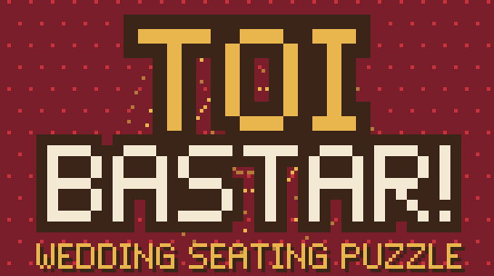
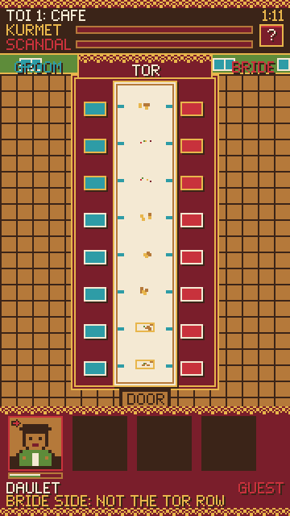
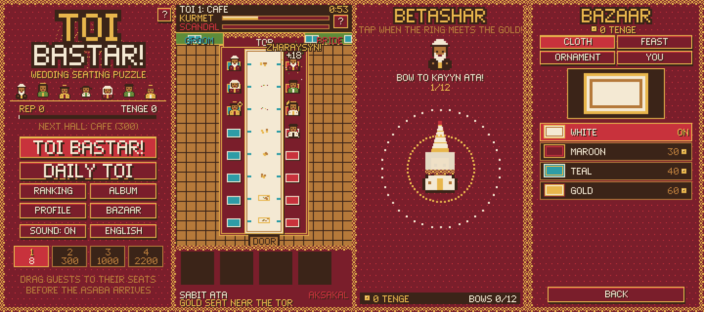

<p align="center"></p>

# Toi Bastar!

**Seat 24 relatives at a Kazakh wedding before the toastmaster arrives, without starting a family scandal.**


<!-- TODO: add once they exist: **[Demo video](URL)** · **[Colosseum submission](URL)** -->
**[▶ Play now](https://toi-bastar-six.vercel.app)** · **[How to play](#how-to-play)** · **[Solana integration](#solana-integration)**

<p align="center"></p>

## About

Toi Bastar! ("Start the toi!") is a pixel-art, mobile-first seating puzzle. You are the host of a toi, a Kazakh
wedding feast, and every guest has an opinion about where they deserve to sit.

Why a toi: seating at a real one is already a puzzle with unwritten rules. Elders go to the tor (the place of honor),
the in-laws face each other, the offended uncle must not end up next to his rival, and one more cousin from the aul
always shows up when every seat is taken. The game turns that into rules you can learn in a minute, in Kazakh, Russian or English.



## How to play

1. Guests queue at the bottom of the screen. **Drag a guest onto a cushion.** Drag seated guests to swap them.
2. Pick a guest up and every free seat shows a green tick (fine) or a red cross (breaks a rule).
3. Seat everyone correctly to fill the **Kurmet** (respect) bar. Mistakes fill the **Scandal** bar; a full scandal bar ends the toi.

**Seating rules** unlock hall by hall, and the azhe (grandmother) explains each new one:

| # | Rule |
|---|------|
| 1 | Elders near the tor, young guests off the tor row |
| 2 | Groom's side on the left, bride's side on the right |
| 3 | Kuda (in-laws) in honored seats, facing their pair |
| 4 | Feuding relatives never next to each other |
| 5 | Kids by the door (each one runs off once) |
| 6 | The late cousin from the aul gets the stool |
| 7 | Nagashy (mother's kin) next to their own family |
| 8 | The surprise akim (mayor) on the tor row |

**Two timers** run at once:

- **Guest patience.** Every guest in the queue has a patience bar. If it runs out, they take offense and the scandal grows.
- **The toi clock.** The asaba (toastmaster) arrives when it hits zero, and whoever is seated then is scored. The music speeds up for the last 20 seconds.

Between halls you play **Shashu** (catch the sweets) and **Betashar** (a rhythm game where the bride bows to the relatives). Both pay tenge.
Four halls: yurt (8 seats), cafe (16), toikhana (24), saray (24, all eight rules).

Full design notes: [docs/game-design.md](docs/game-design.md).

## Solana integration

Everything is live on **devnet**. The puzzle works without a wallet; Solana carries the parts that involve value or other people.

| Feature | On-chain? | How |
|---------|-----------|-----|
| **TENGE, the shashu token** | Yes | Token-2022 mint with on-chain metadata. Tenge earned in the mini-games is claimed to the player's wallet ([mint](https://explorer.solana.com/address/7QLPA8Yo4bhpMZwJ7nzPF8bqpJaRQPWotjqeupBHDqht?cluster=devnet), [claim tx](https://explorer.solana.com/tx/RuzmMstuFoxVcj3Fjy3UVdHQgE4eCZXnGUzNK8t31eokZUT5qH9i1ZnhtU7f7DpK3ipUQ7jER3Xt44R7ZyJgcud?cluster=devnet)) |
| **Guestbook (My Toi)** | Yes | A guest's seat, wish and shashu are **one** transaction to the host: a TENGE `transferChecked` + a Memo. The host's wallet history *is* the guestbook ([example tx](https://explorer.solana.com/tx/4JtQygHrqBHZ2FrsKG6AEaZrn8egsRtE2j7ku4GsCEVPDj2PG2As9Bbbc8RNr6n8o85nDgLhbqB8bKeaqKDURbDX?cluster=devnet)) |
| **Toi Estelygi NFT** | Yes | A snapshot of the finished table minted as a Metaplex Core asset in one collection, image on Arweave via Irys ([collection](https://explorer.solana.com/address/CrXpxMRYa4Xgm8VDGnmHR7Y8h2mhrEA12WorUePgTHxC?cluster=devnet), [mint tx](https://explorer.solana.com/tx/5fxdqFV7XEaUyh1UVW3AFAje7nBDKW8if4BGdr1475DobLWtdPUzMTj2KRJyZTDkzM1pGKiUCuFuXL8bc8QXcE28?cluster=devnet)) |
| **Leaderboard** | Not yet | Upstash Redis behind a Vercel Function. Scores are not signed. Moving it on-chain is on the roadmap |

**Why this needs a blockchain**

- **Shashu is a gift of money.** At a real toi guests throw sweets and coins. In My Toi a guest sends tenge straight to the host's wallet. No game server holds the balance, and the host really owns what they received.
- **The guestbook has no backend.** The invite link carries the toi, the chain stores the wishes. Nobody, including us, can edit or delete a wish or fake the amount next to it: the guestbook shows the actual transfer, not the text of the memo.
- **The memento outlives the game.** A Toi Estelygi NFT sits in the host's wallet and stays there if our site goes down.

Architecture, transaction layouts and trust assumptions: [docs/solana.md](docs/solana.md).

<!-- TODO (track requirement): fill in and uncomment. Only the author knows which parts came from iDos.
## Built with iDos Games

| Generated by iDos AI Coder | Reworked or added by hand |
|----------------------------|---------------------------|
|  |  |
-->

## Tech stack

| Layer | Tech |
|-------|------|
| Game | TypeScript, HTML5 Canvas 2D (180x320, integer scaling), no game engine |
| Art and sound | Sprites, ornament, bitmap font and chiptune generated in code; Web Audio |
| Build | Vite 8, TypeScript 7 |
| Solana | `@solana/web3.js`, `@solana/spl-token` (Token-2022), Metaplex Core + Umi, SPL Memo |
| Storage | Arweave via Irys (NFT image + metadata) |
| Wallets | Phantom, Solflare (injected providers, mobile deep links) |
| Backend | Vercel Functions (`api/`): TENGE claims, NFT co-signing, leaderboard |
| Data | Upstash Redis (leaderboard, rate limits); player profile in `localStorage` |

## Run locally

```bash
git clone https://github.com/heyyAzamat/toi-bastar-game.git && cd toi-bastar-game
npm install
npm run dev        # http://localhost:5173
```

That is enough to play. For the Solana features on devnet:

```bash
node scripts/setup-solana.mjs   # creates the authority key, TENGE mint and NFT collection, writes .env.local
npm run dev                     # the dev server also serves api/*
```

The variables are listed in [.env.example](.env.example). `npm run build` produces a static `dist/`.

## Roadmap

- **Tournaments:** weekly Daily Toi cups with a TENGE prize pool.
- **On-chain leaderboard:** signed scores instead of the current Redis board.
- **Telegram bot:** invite guests to My Toi and get notified about new wishes in chat.
- **New halls:** kyz uzatu, besik toi and sundet toi, each with its own guests and rules.
- **Mainnet:** permanent Arweave storage and server-verified tenge earnings.

## Team

<!-- TODO: add Telegram and X columns -->

| Name | Role | GitHub |
|------|------|--------|
| Azamat | Game design, development | [@heyyAzamat](https://github.com/heyyAzamat) |

## License

[MIT](LICENSE). The music in `public/music/` is third-party and not covered by it.
