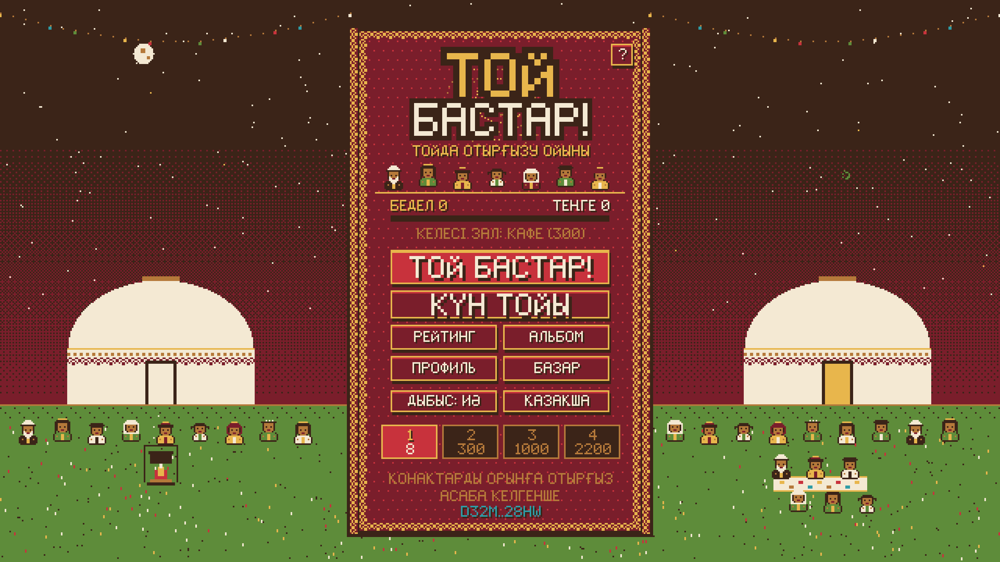

# Game design

Toi Bastar! is a pixel-art, mobile-first seating puzzle set at a Kazakh toi (wedding feast).
180x320 canvas, integer scaling, touch + mouse. Sprites, the koshkar muiz ornament, the 5x7 bitmap font
and the dombra chiptune are generated in code.

## Core loop
- Tap to start (unlocks sound), then **TOI BASTAR!** plays a toi through every hall your reputation has unlocked, with a mini-game between halls. **DAILY TOI** is one fixed challenge per UTC day (same seed and hall for everyone) with its own leaderboard.
- Guests queue at the bottom. Drag one onto a cushion; drag seated guests to swap. Tap or pick up a guest and every free seat shows a green tick (fine) or red cross (breaks a rule).
- Two clocks run at once: each guest's **patience** bar (they walk out if it empties) and the **wave timer** until the asaba (toastmaster) arrives.
- Two bars score the toi: **Kurmet** (respect, earned for correct seats) and **Scandal** (raised by mistakes and walk-outs). A full scandal bar ends the toi.
- Stars come from the share of guests seated perfectly and the scandal level (Zhaman / Zhaksy / Uly toishy).

## Rules
Rules unlock hall by hall, and the azhe (grandmother) explains each new one in a speech bubble the first time.

| # | Rule |
|---|------|
| 1 | Elders sit near the tor (the place of honor); young guests stay off the tor row. |
| 2 | Groom's side sits on the left, bride's side on the right. |
| 3 | Kuda (in-laws) take honored seats and face their pair across the table. |
| 4 | The offended relative arrives after their rival and must not sit next to them. |
| 5 | Kids sit by the door; each kid runs off once and must be reseated. |
| 6 | When every seat is full, a cousin from the aul arrives, a stool appears, and someone must move to it. |
| 7 | Nagashy (mother's kin) sit next to same-colour family. |
| 8 | The surprise akim (mayor) goes on the tor row. |

Portrait badges: side arrow (blue left / red right), up arrow = near the tor, down arrow = by the door,
ring = kuda pair, bolt + number = feud, colour dot = nagashy family, house = cousin from the aul.

## Halls

| Hall | Seats | Reputation to unlock | Rules |
|------|-------|----------------------|-------|
| Yurt | 8 | 0 | 1-2 |
| Cafe | 16 | 300 | 1-4 |
| Toikhana | 24 | 1000 | 1-6 |
| Saray (palace) | 24 | 2200 | 1-8, shorter patience |

Every generated hall has at least one perfect seating (`src/waves.ts`).

## Tutorial, mini-games, meta
- First **TOI BASTAR!** runs a guided lesson: 4 scripted guests, a pointing hand, azhe tips. Wrong seats are refused without penalty. **?** on the start screen replays it.
- Between halls, **Shashu** (tap falling sweets) alternates with **Betashar**, where the bride bows to 12 relatives on the beat. Taps are judged against the audio clock (±0.09 s perfect, ±0.18 s good), and the veil lifts at the end. Both pay out tenge.
- **Bazaar:** tenge buys tablecloths, feast dishes (baursak, kazy-karta), the UI ornament colour and your look (used as your avatar in My Toi).
- **Reputation** (sum of toi scores) unlocks halls; the **Aul album** collects every guest type met.
- **Share:** result and final screens make a pixel card (with the table snapshot) and send it through the phone's share sheet. On desktop the card is downloaded and Telegram's share page opens.

## Feedback
Green smile or red "Hm!" bubble over each seated guest; offended guests walk out through the door; the screen
shakes when the scandal rises; "Oibai!" on mistakes, coin clink in Shashu, applause when the asaba arrives.

## Languages
Kazakh, Russian, English (`src/i18n.ts`). The first launch follows the device language; the start screen has a switch.
The pixel font includes Latin and Cyrillic, with the Kazakh letters Ә Ғ Қ Ң Ө Ұ Ү Һ І.

## Audio
- The toi (hall waves): `public/music/toi.mp3`, Dos-Mukasan "Barinen de sen sulu" (rap remix). It starts from the top each wave and plays at 1.1x with 20s left, 1.2x with 10s left.
- Menus and Shashu: `public/music/bipyl.mp3`, "Bipyl" (Jamal Omarova, rap remix v2).
- Hall intro card and results: the generated dombra chiptune.
- Voice: the azhe's "Oibai!" (macOS Kazakh voice *Aru*, `public/voice/`). The other sounds are synthesized.
- Both songs are third-party recordings and are **not** covered by the MIT license: clear the rights before any public release, or swap the files.

## Desktop
On wide screens the portrait game sits in the middle of a night-steppe toi (yurts, garlands, fireworks,
campfire, dancers). Phones keep the plain frame and respect safe areas.

## Dev shortcuts
Dev builds only: `?wave=4` jumps straight into a hall (1-4), `?speed=4` fast-forwards time,
`?scene=shop` opens a scene directly, `?fakewallet=1` installs a Phantom-shaped wallet backed by a local devnet keypair.
